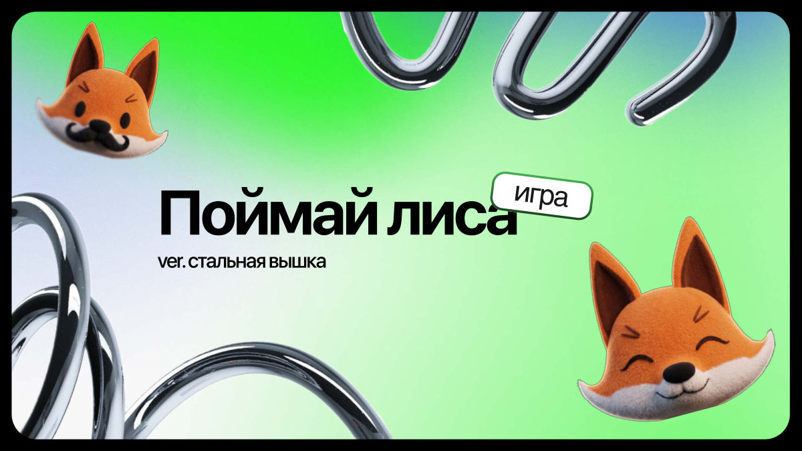

# Поймай Лиса

Игра-тренажёр для **детей 9–11 лет**: учит **узнавать мошенников в переписке** и **показывать подозрительное взрослому**.

> **Размер игры: 242 КБ из 5 МБ** (21 файл, без внешних зависимостей)

**Поиграть:** https://lastnart.github.io/SberHSE-hack/ (лучше с телефона, в вертикальном положении).

**О хакатоне.** Участвовали в хакатоне **HSE × Sber Mobile Hack «Создаем эмоции»**, трек **«Игры»**, в команде «Стальная вышка». Требования: мини-игра для приложения **СберKids** на **чистых HTML, CSS и JS**, **до 5 МБ**, без внешних ресурсов, связь с приложением только через **пять событий**.

**Что сделали.** Ребёнок становится **стражем ворот**. К воротам приходят гости: виден только **силуэт с «?»** и их сообщение. Нужно найти в тексте **хитрости мошенника** (**спешка**, **просьба пароля**, **слишком щедрый подарок** и другие) и решить: **«Показать взрослому»** или **«Пустить»**. Лис раскрывается после решения, ошибки разбираются **без страшилок**. **19 сценариев**, **3 волны**, по **9 гостей** за партию.

**Презентация:** [docs/presentation.pdf](docs/presentation.pdf)
